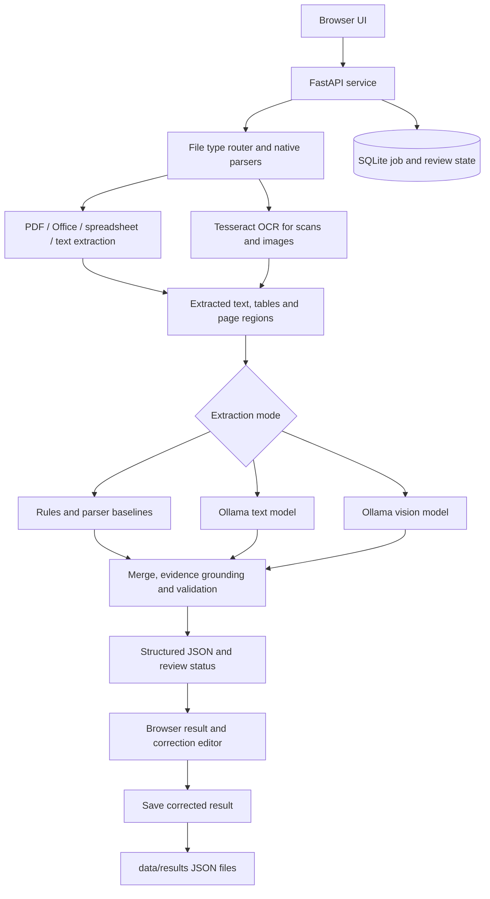

# DocuSense — Local Document Intelligence

DocuSense is a local-first document extraction prototype. It turns PDFs, images, spreadsheets, and office documents into structured JSON, shows the evidence and validation warnings behind extracted values, and lets a person correct the result before saving it.

The project is designed around **document-by-document extraction and human review**. It does not assume every invoice, marksheet, certificate, or business document has the same layout.

## What it does

- **Document ingestion:** PDF, common image formats, DOCX, XLSX/XLSM, PPTX, OpenDocument files, CSV, TXT, Markdown, JSON, XML, HTML, RTF, and LOG. Legacy DOC/XLS/PPT conversion requires LibreOffice.
- **Text and OCR extraction:** native document parsers plus optional local Tesseract OCR for scans and images.
- **Local GenAI extraction:** optional Ollama text and vision models. The default model tags are `qwen2.5:3b` and `qwen2.5vl:3b`.
- **Schema-based output:** general extraction, invoice/receipt and marksheet profiles, or a user-provided JSON schema.
- **Evidence and validation:** evidence quotes/page references where available, OCR disagreement reporting, missing-field and review warnings, and deterministic invoice arithmetic checks.
- **Human-in-the-loop review:** edit scalar fields and table rows, add/remove rows, save a review note, and download the corrected JSON.
- **Local persistence:** job/review state in SQLite and extraction result files under `data/results/`.

## Architecture



The browser communicates with FastAPI on localhost. Ollama is a separate local model runtime. OCR and native parsers prepare the source content; rules and/or a local model produce structured fields and tables; validation checks evidence and supported consistency rules; the UI presents the result for human review.

## Requirements

- Windows 10/11 and Python 3.11+
- Git
- Tesseract OCR for scanned PDFs and image OCR
- Ollama for text/vision model modes (optional for rules-only mode)
- LibreOffice only if you need legacy `.doc`, `.xls`, or `.ppt` conversion

## Windows setup

Open PowerShell in the cloned repository.

### 1. Create the Python environment

```powershell
Remove-Item Env:PYTHONHOME -ErrorAction SilentlyContinue
Remove-Item Env:PYTHONPATH -ErrorAction SilentlyContinue
py -3.11 -m venv .venv
.\.venv\Scripts\python.exe -m pip install --upgrade pip
.\.venv\Scripts\python.exe -m pip install -r requirements.txt
```

### 2. Configure environment variables

```powershell
Copy-Item .env.example .env
```

The defaults are suitable for local development. Keep `APP_ENV=development` and leave `APP_API_KEY` blank for a private localhost demo. If you set an API key, enter the same value in the app's API key field. Do not commit `.env` or real keys.

To enable encryption for supported SQLite-stored result/review data, generate a Fernet key:

```powershell
.\.venv\Scripts\python.exe -c "from cryptography.fernet import Fernet; print(Fernet.generate_key().decode())"
```

Put the generated value in `DATA_ENCRYPTION_KEY` in your local `.env` and keep it safe. Do not lose the key. Result JSON files in `data/results/` are local files; protect that folder separately.

### 3. Install and check Tesseract

Install Tesseract OCR for Windows and ensure `tesseract.exe` is on PATH. Verify:

```powershell
tesseract --version
tesseract --list-langs
```

The default OCR language is English (`eng`). Install additional Tesseract language data and set `OCR_LANGUAGE` if you need another language.

### 4. Install and pull local models (optional)

Install Ollama, then run:

```powershell
ollama pull qwen2.5:3b
ollama pull qwen2.5vl:3b
ollama list
```

The text and vision modes require Ollama and the corresponding model. Rules/OCR mode does not require Ollama.

### 5. Start DocuSense

```powershell
powershell -ExecutionPolicy Bypass -File .\start_document_lab.ps1
```

The launcher starts Uvicorn on `127.0.0.1:8000`, checks `/health`, and opens the browser. Visit [http://127.0.0.1:8000](http://127.0.0.1:8000).

To stop the service when it was started by the launcher:

```powershell
powershell -ExecutionPolicy Bypass -File .\stop_document_lab.ps1
```

## Quick demo

Use **synthetic documents only** for a public demonstration. Do not use personal marksheets, certificates, IDs, resumes, payment records, or real customer documents.

1. Start Ollama if you plan to use a model mode, and start DocuSense.
2. Create a fictional one-page invoice in Word or a spreadsheet and export it as PDF. Use invented company names, addresses, invoice IDs, and amounts.
3. In the browser, upload the PDF. Choose **Invoice or receipt** for the field profile.
4. Run **OCR + local structuring** first, or choose **Automatic** to use Ollama when available.
5. Inspect the extracted fields, line-item table, OCR text, evidence, and any review warnings.
6. Select **Review and correct**. Correct a value or table row, add/remove a row if needed, and optionally enter a review note.
7. Select **Save corrections**, then **Download JSON**. Confirm that the downloaded JSON contains the corrected values.
8. Repeat with a fictional certificate or marksheet only if you want to demonstrate a second document layout.

A ready-to-follow synthetic example and presentation checklist are in [docs/DEMO_GUIDE.md](docs/DEMO_GUIDE.md).

## Extraction modes

| Mode | Behaviour |
| --- | --- |
| `rules` | Native parser/OCR text plus local rules and parser tables; no Ollama required |
| `text` | Local Ollama text model using extracted text |
| `vision` | Local vision model with OCR/parser text context |
| `vision_zero_shot` | Local vision model without OCR text context |
| `auto` | Uses local Ollama when available and falls back to local OCR/rules when unavailable |

The UI also supports custom schemas. For example:

```json
{
  "document_type": "invoice",
  "fields": {
    "invoice_number": "string",
    "date": "date",
    "vendor": "string",
    "subtotal": "number",
    "tax": "number",
    "total": "number"
  }
}
```

## Tests

Run the automated regression suite from PowerShell:

```powershell
Remove-Item Env:PYTHONHOME -ErrorAction SilentlyContinue
Remove-Item Env:PYTHONPATH -ErrorAction SilentlyContinue
.\.venv\Scripts\python.exe -m unittest discover -s tests -v
git diff --check
```

The latest user-reported Codespaces run completed **38 tests successfully**. These tests cover application/parser/validation behaviour using generated test inputs; they are not a real-world document accuracy benchmark. Run the commands again on your current checkout before presenting a fresh test result.

## Important limitations

- OCR and model output can be wrong, omit table rows, or confuse columns. Always compare important values with the source document.
- Evidence matching and confidence indicators are heuristics, not calibrated probabilities.
- A result marked as passed does not guarantee that every extracted value is correct.
- Invoice arithmetic checks cover supported deterministic checks; they are not a complete accounting rules engine.
- Results vary with scan quality, document layout, language data, model choice, and available hardware.
- The asynchronous job queue is process-local. This is a local prototype, not a production multi-user deployment.
- Fine-tuning utilities are optional; a fine-tuning run is not part of the demonstrated workflow.
- No universal accuracy claim is made across document types or layouts.

## Privacy and safe use

DocuSense is configured for local use and binds its Windows launcher to localhost. Uploaded originals are processed in memory rather than persisted as original files by the application. Extracted JSON results and application data are stored locally. Keep personal source documents and result files out of the public repository, and configure appropriate access controls and encryption before exposing the service beyond localhost.

## Repository layout

```text
app/                  FastAPI application, parsers, models and validation
app/static/           Browser interface
scripts/              Optional evaluation, backup and model utilities
tests/                Automated regression tests
data/results/         Local extraction result JSON (do not commit)
start_document_lab.ps1
stop_document_lab.ps1
requirements.txt
```

## License and model notes

Check the repository's license and the license/usage terms for each model checkpoint before redistributing or deploying it. Ollama models are downloaded separately and are not bundled with DocuSense.
